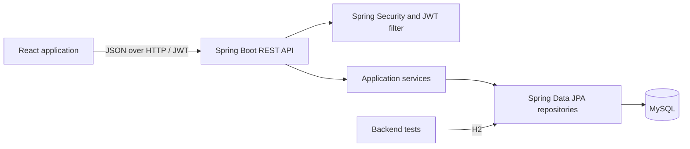

# Employee Management System

A full-stack web application for managing employee accounts and common HR workflows. It includes role-based admin and employee experiences, attendance tracking, leave requests, support requests, and employee profiles.

## Features

### Administrator

- Create, search, edit, and remove employee accounts.
- Record or update daily attendance as Present, Late, or Absent.
- Review and process employee leave requests.
- Review and resolve employee support requests.

### Employee

- View a personal dashboard and profile.
- View personal attendance history and attendance statistics.
- Submit leave requests and track their status.
- Submit support requests and track their status.

### Security and application behavior

- JWT-based authentication with role-based endpoint authorization.
- First-administrator setup is available only while the database has no accounts.
- Passwords are stored using BCrypt hashing.
- Request DTO validation and a shared API validation-error response.
- MySQL persistence, with H2-backed backend tests.

## Technology

| Area | Technologies |
|---|---|
| Frontend | React, React Router, Axios, Vite |
| Backend | Java 25, Spring Boot, Spring Security, Spring Data JPA |
| Database | MySQL; H2 for tests |
| Authentication | JWT and BCrypt |
| Build and validation | Maven Wrapper, npm, ESLint |

## Architecture



The frontend calls the backend through `/api`. During local development, Vite proxies `/api` and `/uploads` to `http://localhost:8080`.

## Run locally on Windows

### Prerequisites

- JDK 25
- Node.js and npm
- MySQL running locally

Create the database and a local application user in MySQL (choose your own password; do not commit it):

```sql
CREATE DATABASE employee_management;
CREATE USER 'employee_app'@'localhost' IDENTIFIED BY 'choose-a-local-password';
GRANT ALL PRIVILEGES ON employee_management.* TO 'employee_app'@'localhost';
```

Open **two PowerShell terminals** from the repository root.

### 1. Start the backend

In the first terminal:

```powershell
cd .\backend
$env:DB_URL = "jdbc:mysql://localhost:3306/employee_management?useSSL=false&allowPublicKeyRetrieval=true&serverTimezone=UTC"
$env:DB_USERNAME = "employee_app"
$env:DB_PASSWORD = "choose-a-local-password"
$jwtBytes = New-Object byte[] 48
[Security.Cryptography.RandomNumberGenerator]::Create().GetBytes($jwtBytes)
$env:JWT_SECRET = [Convert]::ToBase64String($jwtBytes)
.\mvnw.cmd spring-boot:run
```

Keep this terminal open. The API listens on port `8080` by default.

### 2. Start the frontend

In the second terminal:

```powershell
cd .\frontend
npm ci
npm run dev
```

Open the local URL printed by Vite, usually `http://localhost:5173`.

### 3. Create the first administrator

On a new, empty database, use the initial administrator setup form on the login page. Choose a strong password of at least 16 characters. After the first account has been created, the first-admin setup endpoint refuses further registrations; use the admin account to create other users.

> Do not use real employee data or reuse a personal password in a demo database. Keep database credentials and JWT secrets out of source control.

## Run checks

Backend tests:

```powershell
cd .\backend
.\mvnw.cmd clean test
```

Frontend lint and production build:

```powershell
cd .\frontend
npm ci
npm run lint
npm run build
```

## API overview

All application endpoints use the `/api` prefix. Protected endpoints require a valid bearer token and the appropriate role.

| Area | Example endpoints |
|---|---|
| Authentication | `POST /api/auth/login`, `GET /api/auth/setup-status`, `POST /api/auth/register-first-admin` |
| Employees | `GET /api/users`, `POST /api/users`, `PUT /api/users/{id}`, `DELETE /api/users/{id}` |
| Attendance | `GET /api/attendance?date=YYYY-MM-DD`, `POST /api/attendance`, `GET /api/attendance/me` |
| Leave | `POST /api/leaves`, `GET /api/leaves`, `PUT /api/leaves/{id}/status` |
| Support | `POST /api/support`, `GET /api/support`, `PUT /api/support/{id}/resolve` |
| Profile | `GET /api/profile/me`, `PUT /api/profile/me`, `POST /api/profile/me/photo` |

## Interview demo

Use [docs/INTERVIEW_DEMO.md](./docs/INTERVIEW_DEMO.md) for a short demo plan, preparation checklist, and project discussion points.
Use [docs/INTERVIEW_PREPARATION.md](./docs/INTERVIEW_PREPARATION.md) to review the project introduction, technology explanations, common questions, and a four-week practice plan.
For a code-by-code walkthrough with screenshots, see [the printable PDF](./docs/INTERVIEW_PROJECT_WALKTHROUGH.pdf) or its [Markdown source](./docs/INTERVIEW_PROJECT_WALKTHROUGH.md).

## Deployment

See [DEPLOYMENT.md](./DEPLOYMENT.md) for Railway deployment instructions.

## Current scope and next steps

Attendance is recorded by an administrator for a selected date; the system does not currently provide employee clock-in/clock-out or automatic absence detection. Useful next steps include adding tests for more workflows, attendance audit history, and automated deployment checks.
