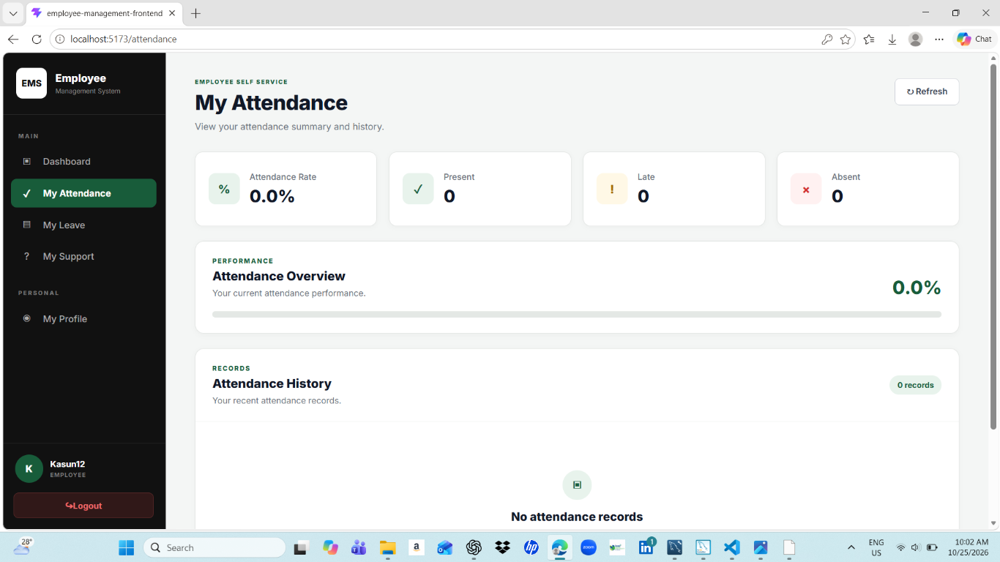
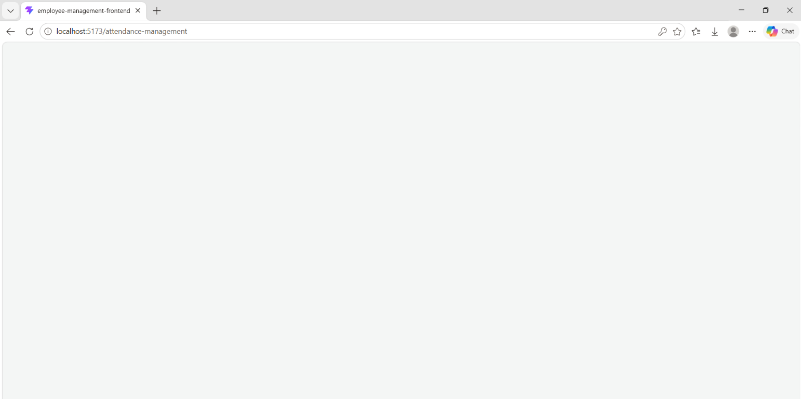

# Interview Walkthrough: Employee Management System

This document explains the project, where its main features are implemented, and how to discuss them in an internship interview. The companion PDF is `docs/INTERVIEW_PROJECT_WALKTHROUGH.pdf`.

## Project location

Repository root:

```text
C:\Users\MALSHI\OneDrive - NSBM\Desktop\My Employee Management System\employee-management-system
```

In VS Code, open this folder. Use **Ctrl+P** and type a filename to open any file listed below.

## What the project is

This is a full-stack employee management web application. Administrators manage employee accounts and HR workflows. Employees can view their own information and submit requests.

Technology stack:

- Frontend: React, JavaScript/JSX, React Router, Axios, Vite, ESLint.
- Backend: Java 25, Spring Boot, Spring Web, Spring Security, Spring Data JPA/Hibernate.
- Data: MySQL for application storage; H2 in-memory database for backend tests.
- Authentication: JWT bearer tokens, role-based authorization, BCrypt password hashes.

## Main feature flows

### Administrator records attendance

1. Admin navigates to `/attendance-management`.
2. React loads employees from `GET /api/users` and the selected day's records from `GET /api/attendance?date=YYYY-MM-DD`.
3. Admin selects Present, Late, or Absent and saves.
4. React sends `POST /api/attendance` with `userId`, `date`, and `status`.
5. The backend validates the request. The service creates or updates the employee's attendance record for that date.
6. Employee views their own records through `/api/attendance/me`.

Attendance is manual. The app does not clock employees in/out or automatically mark unrecorded days absent.

## Screenshots shared during troubleshooting

These are the user's screenshots from the earlier attendance troubleshooting session. They document the observed state at that time; they are not a claim that the same data or page state is present now.





For a current interview demo, sign in with fictional accounts, record sample attendance, and take fresh screenshots after confirming the feature works on the current build.

## Files added

### Attendance management

- `frontend/src/components/AttendanceManagement.jsx` — admin UI to pick a date, search employees, choose statuses, save, and see the daily counts.
- `frontend/src/components/AttendanceManagement.css` — responsive styling for that UI.

### Documentation

- `docs/INTERVIEW_PROJECT_WALKTHROUGH.md` — source notes for this PDF.
- `docs/INTERVIEW_PROJECT_WALKTHROUGH.pdf` — printable interview guide.
- `docs/interview-images/employee-attendance-before.png` and `docs/interview-images/attendance-admin-before.png` — copies of the two supplied attendance screenshots.

## Files changed

- `frontend/src/App.jsx` — registers `/attendance-management` route.
- `frontend/src/components/Sidebar.jsx` — adds the admin Attendance link.
- `backend/src/main/java/com/example/employee_management/controller/AttendanceController.java` — adds admin-only date-filtered attendance retrieval.
- `backend/src/main/java/com/example/employee_management/dto/AttendanceRequestDto.java` — validates positive employee ID, non-null fields, and non-future attendance date.
- `backend/src/main/java/com/example/employee_management/repository/AttendanceRepository.java` — adds date-based attendance lookup.
- `backend/src/main/java/com/example/employee_management/service/AttendanceService.java` — adds retrieval of attendance for a selected date.
- `README.md` — describes app setup, features, API, security notes, and interview docs.
- `DEPLOYMENT.md` — documents deployment.

The active local `backend/src/main/resources/application.properties` is ignored by Git in this repository. Do not put secrets into a tracked example file.

### Startup error in the terminal screenshot

The latest terminal output says:

```text
Could not resolve placeholder 'JWT_SECRET' in value "${JWT_SECRET}"
```

This means the backend was started without the required JWT signing secret. In the same PowerShell window, from the backend directory, set a random local JWT secret before starting Spring:

```powershell
$jwtBytes = New-Object byte[] 48
[Security.Cryptography.RandomNumberGenerator]::Create().GetBytes($jwtBytes)
$env:JWT_SECRET = [Convert]::ToBase64String($jwtBytes)
.\mvnw.cmd spring-boot:run
```

For the database, the local `application.properties` has defaults, but the database must exist and MySQL must be running. If it reports a connection or access-denied error, set these using your own local MySQL values in the same terminal:

```powershell
$env:DB_URL = "jdbc:mysql://localhost:3306/employee_management?useSSL=false&allowPublicKeyRetrieval=true&serverTimezone=UTC"
$env:DB_USERNAME = "your-mysql-username"
$env:DB_PASSWORD = "your-mysql-password"
```

Set the values before the run command. A value entered with `$env:NAME = ...` applies to that PowerShell window; reopening a terminal means setting it again. For a hosted deployment, use stable secrets from the host's environment-variable settings. Do not paste secrets into a screenshot or chat.

## How to explain the design

> “The React frontend uses Axios to call a Spring Boot REST API. Protected requests include a JWT bearer token. Spring Security validates the token and role, controllers handle HTTP requests, services implement workflows, and Spring Data repositories access MySQL through JPA/Hibernate.”

For attendance:

> “The employee screen was empty because attendance is not automatic. I added the missing administrator workflow and a date query. Admins explicitly save a status; employees can then retrieve only their own attendance.”

## Run locally and verify

Start the backend in PowerShell from the repository root:

```powershell
cd .\backend
$env:DB_URL = "jdbc:mysql://localhost:3306/employee_management?useSSL=false&allowPublicKeyRetrieval=true&serverTimezone=UTC"
$env:DB_USERNAME = "your-mysql-username"
$env:DB_PASSWORD = "your-mysql-password"
$jwtBytes = New-Object byte[] 48
[Security.Cryptography.RandomNumberGenerator]::Create().GetBytes($jwtBytes)
$env:JWT_SECRET = [Convert]::ToBase64String($jwtBytes)
.\mvnw.cmd spring-boot:run
```

MySQL must be running and the database must exist. `JWT_SECRET` is required.

Start the frontend in another terminal:

```powershell
cd .\frontend
npm run dev
```

Checks used:

```powershell
# backend
cd .\backend
.\mvnw.cmd test

# frontend, from repository root in a separate terminal
cd .\frontend
npm run lint
npm run build
```

The backend tests, frontend lint, and frontend production build were previously validated. The later terminal run failed at startup because `JWT_SECRET` was not set; the PowerShell commands above address that specific error.

## Interview-safe honesty

- Do not claim attendance is automatic; an admin enters it.
- Do not show passwords, tokens, or other secrets in screenshots or screen sharing.
- If you have not personally tested a behavior, say so and explain how you would verify it.
